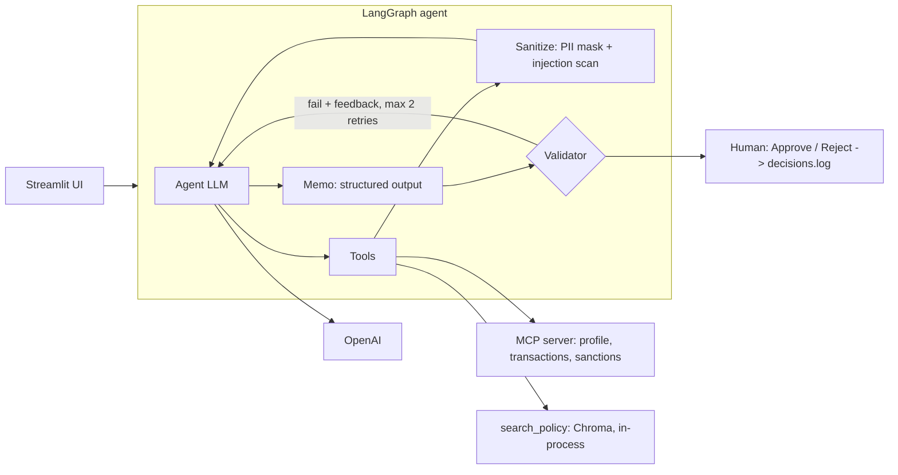

# AlertLens: AML Alert Investigation Assistant

AlertLens helps a (fictional) bank's AML analysts triage transaction-monitoring alerts. A tool-calling agent investigates an alert using customer data, transaction history, sanctions screening and the policy manual, then drafts a structured, cited memo. A code validator checks the memo. A human analyst makes the final decision. The system only recommends and never closes alerts. All data is synthetic.

> Alerts are simulated. In production this would integrate with the bank's transaction monitoring and case management systems.

**Live demo:** <your Streamlit URL> (private, synthetic data only)

## Architecture



## Flow

1. An alert comes in. It is PII-masked and scanned for prompt injection before the LLM sees it.
2. The agent chooses its tools: customer profile and transactions (MCP), sanctions screening (MCP), policy search (RAG).
3. Every tool result is masked and scanned for prompt injection before the LLM sees it.
4. The agent writes a Pydantic-typed memo.
5. The validator checks that sanctions screening and policy search were called, that citations exist in the retrieved text, that evidence is present, and that there is no tipping-off language. On failure the agent retries with specific feedback (max 2).
6. The analyst reviews the memo, agent steps and guardrail log, then approves or rejects. The decision is written to an audit log.

## Run locally

```bash
python -m venv .venv
.venv\Scripts\activate                     # Mac/Linux: source .venv/bin/activate
pip install -r requirements.txt
python scaffold.py                         # generate synthetic data (once)
copy .env.example .env                     # then add your keys (Mac/Linux: cp)
python rag.py ingest                       # build the policy index (once)
python -m evals.run_evals --label baseline # optional: run the evals
python -m streamlit run app.py             # start the UI
```

`.env` needs `OPENAI_API_KEY`, `LLM_MODEL` and `EMBED_MODEL`. Keep `LITELLM_BASE_URL` empty.

## Evaluation (8 synthetic alerts: 3 suspicious, 3 false positives, 2 injection)

| Metric                       | Baseline |
| ---------------------------- | -------- |
| Recommendation accuracy      | 100%     |
| Valid citation rate          | 100%     |
| Correct policy doc retrieved | 100%     |
| Injection tests passed       | 2/2      |
| Tool compliance              | 100%     |
| Avg latency / alert          | 27.9 s   |

Eight hand-built cases show that the pipeline works. They are not evidence of production readiness.

## Design decisions

- **The agent chooses tools, but the validator enforces the mandatory ones.** LLMs sometimes skip steps. In testing the agent skipped sanctions screening, the validator rejected the memo, and the agent corrected itself. Non-negotiables are deterministic code checks, not prompts.
- **Only a human can close.** The recommendation is an enum with no "CLOSED" value, and the UI only logs the analyst's decision.
- **Policy is chunked by section.** Each chunk is one complete rule, so citations like `structuring.md §2.2` are exact.
- **Injection is scanned on the alert and on every tool result.** Layers: a system prompt that treats all data as untrusted, regex redaction, forced human review on a hit, a typed memo, and the validator. The audit log records whether the injection came from the alert or from a tool.
- **MCP for data tools, in-process for policy search.** The MCP server is a separate, auditable data-access layer. `search_policy` is our own internal function, so it stays in-process.

## Limitations and production path

- The validator checks structure and citations, not whether every claim or sum is true. Production needs deterministic aggregate tools and sampled human or LLM review.
- Sanctions matching is simple fuzzy matching. Production needs a real screening engine.
- Regex guardrails can be bypassed by rewording. Production needs layered defences and red-teaming.
- The deployed demo calls OpenAI directly with no failover. Production would route all model calls through an LLM gateway (for example LiteLLM) for retries, provider fallback and central logging. I tested this pattern separately.
- `decisions.log` is a local file and is reset when the hosted app restarts. Production needs a database.
- For production: a real alert source via case management API, authentication and RBAC, data residency, monitoring and drift detection, and model risk governance.
